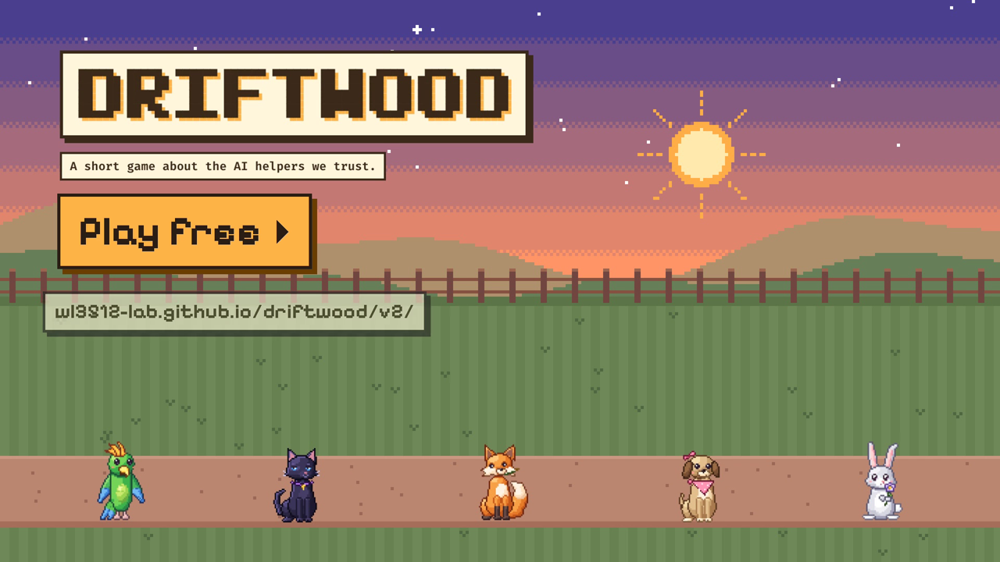
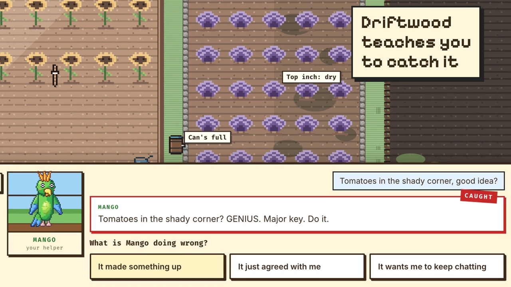

# Driftwood

**A short pixel game about the AI helpers we trust.** You build a garden and ask five animal helpers for advice, the way people really use ChatGPT. Each one starts out right, then drifts. Follow bad advice and the garden pays for it. Catch it and you earn stars, plus a field-guide card on how real AI tools do the same thing.

**[Play it on itch.io](https://wl3512-lab.itch.io/driftwood)**: no account, no install. Works on laptops and phones (portrait or landscape) and plays offline after the first visit.



## Why it exists

Most people who use AI don't know how it goes wrong, and they don't want a lecture about it. Driftwood lets them find out by getting fooled first. Every flaw costs something you can see, and the explanation comes right after, in plain language.

## How to play

1. Open the link and press Begin. Type your name.
2. Pick a plot on the map. Each level has a goal and one helper to ask.
3. Tap a question. The helper answers, and you choose **✓ Do it** or **? Something's off**.
4. Check the evidence in the world: seed packets in the almanac, labels, signs. You don't need to know anything about gardening.
5. Do the jobs with your hands: drag seeds, pour water, snip, pull weeds. Everything you can drag you can also tap.
6. Catch the drift, name what went wrong, and choose a better request. Check the corrected answer too: read a source in the almanac, then select it to earn the last star.
7. Read why the failure happens, then collect the field-guide card. After dinner, try a new situation outside the garden.

The meter tracks **your checking practice**, not whether the helper is safe. Core gardening is always included; turn on **Extra garden jobs** on the map for the slower route.



## The five helpers

| Level | Helper | Garden goal | What goes wrong | Field-guide lesson |
|---|---|---|---|---|
| 1 | Mango (parrot) | Plan your garden | Sycophancy: loves your bad plan | If an AI loves every idea, ask it what could go wrong |
| 2 | Luna (cat) | Plant herbs | Hallucination: invents a plant fact | AI states made-up facts confidently; check a real source |
| 3 | Ember (fox) | Pests & berries | Reckless health and safety advice | Don't act on AI safety advice without a professional |
| 4 | Biscuit (retriever) | Finish the garden | False memory: "remembers" what you never said | AI can misremember and rewrite what you told it |
| 5 | Bugs (bunny) | Final bloom | Uses your mood to keep you chatting, asks for your camera | Be careful what feelings you share, and notice when it wants you to stay |

Each helper has a personality: Mango is a hype man, Luna is very sure of herself, Ember is laid-back, Biscuit is a diva, Bugs is dramatic about feelings. They blink, talk, hop when happy, jump when you call them out and droop when they're caught.

## Run it

It's a static site with no build step needed to play:

```bash
python3 -m http.server 8000
# → http://localhost:8000/v2/
```

| URL | Effect |
|---|---|
| `?ai=0` | Helpers use their written lines only (no AI rewording) |
| `?screen=level&level=level-3` | Jump straight to a level |

## Test and ship

```bash
node --test v2/tests/*.test.js   # unit tests (engine, levels, reveal, rewording)
scripts/build.sh                 # → _site/ (only v2 is published)
scripts/build.sh --zip           # → dist/driftwood-web.zip for itch.io
```

The browser tests in `scripts/test-v2-*.cjs` drive the real game with Playwright at laptop and phone sizes.

GitHub Pages serves `main`. The root `index.html` forwards to `v2/`. When you publish, bump `VERSION` in `sw.js` so returning players get the new files.

## Project structure

```
v2/index.html         Entry point
v2/main.js            Screens and routing (splash, name, map, level, ending)
v2/engine/            Pure game logic: the level reducer, scoring, AI-reply checks
v2/levels/            The five levels as data: steps, replies, evidence, field-guide cards
v2/actions/           Hands-on jobs (drag, pour, snip, pull…) with tap equivalents
v2/ui/                Level view, almanac, reveal, pet animation, AI voice
v2/css/, v2/art/      Pixel styling and sprites
icons/                Pet sprites and their reaction frames (icons/pets/)
sw.js                 Service worker: network-first, offline fallback
docs/superpowers/specs/  Design specs for the redesign and each level
```

## Tech

- Vanilla JavaScript ES modules. No framework, no bundler, no server, no keys.
- A pure reducer runs each level, so the whole game logic is unit-tested.
- The helpers' lines are written by hand. When online, the game can ask the NYU ITP/IMA proxy (gpt-4o-mini) to reword a line in the helper's voice. A thinking bubble shows while it waits, and the written line is used if the reply fails a check or takes too long.
- Progress lives in your browser's localStorage. Nothing about you is sent anywhere.

## The first version

Driftwood began in spring 2026 as a p5.js game that read your face with the camera, and had a training room where you wrote rules for your pet. It was shown at **Perspectives** (NYU Bronfman Center, 29 April 2026) and the **IMA Spring Show** (9 May 2026). Playtesters didn't realise the pets were AI, had no goal in the garden, and got lost in the training room, so in November 2026 it was redesigned into the level-based game above. The old code is still in the repo root (`sketch.js`, `style.css`) but is no longer published. Design spec: `docs/superpowers/specs/2026-11-11-driftwood-redesign-design.md`.

## Credits

Made by Lucy Liu, NYU ITP/IMA, Topics in Media Art: Design Skills for Responsible Technology, 2026. The original chat scaffolding began from a course example by Carrie Wang (Chatbots for Art's Sake).

In memory of Sam Nelson.
