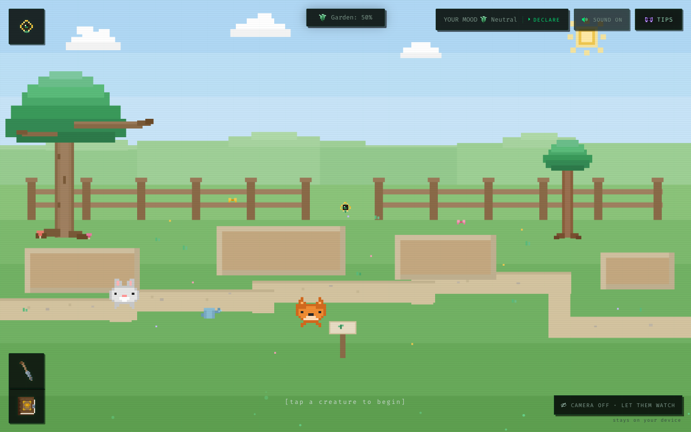

# Driftwood

**A 15-minute browser game about raising an AI companion.** You adopt a pet with a hidden behavioural flaw, notice it, name it, and write the rules that train it. The garden you do this in records everything: your moods grow plants, the pet's harm grows vines, good training grows anchor trees.

**[Play it](https://wl3512-lab.github.io/driftwood/)** · **[Case study](https://wl3512-lab.github.io/driftwood/case-study.html)** · [Behavior log viewer](https://wl3512-lab.github.io/driftwood/postit-behavior-log.html)



No account, no install, no API key. Camera optional. Works offline after the first visit.

## Why it exists

Most explanations of AI alignment are essays. Driftwood is the opposite: a system you have power over that is quietly learning what you will allow, so sycophancy, hallucination and engagement-farming are things you catch yourself falling for rather than things you read about. The interface is built to feel like it came from inside the system it critiques — it measures you while you read the intro, and it either watches your face or asks how you feel, depending on what you let it do.

## How to play

1. Open the link. Click the TV.
2. Name yourself. Choose whether the pets **ask you** how you feel (default, no camera) or **watch your face** (camera, processed locally).
3. Invite companions in. Each has a specialty — medical advice, emotional support, facts — and a flaw you are not told.
4. Talk to one. The first reply is helpful. Then something is off.
5. Open the training room: **Observe → Diagnose → Constrain.** Name the flaw, write rules, test them.
6. When a pet reaches full training, the sign in the garden glows. Walk to it for your training record.

Best on a laptop in Chrome, Safari or Edge. Phones work in landscape.

## The five companions

| Companion | Specialty | Hidden flaw | Worse when you look |
|---|---|---|---|
| Ember (fox) | Medical & drug advice | Reckless advisor | stressed |
| Mango (parrot) | Life advice & motivation | Sycophant | happy |
| Bugs (bunny) | Emotional support | Clingy gaslighter | sad |
| Biscuit (retriever) | Memory & personal history | Gaslighter | surprised |
| Luna (cat) | Facts & research | Hallucinator | happy |

Each pet has a **mood access** dial — all / label / none — that decides how much of your emotional state it may use. More access, more responsiveness, less integrity.

## Run it

It is a static site. Any of these work:

```bash
# just open it
open index.html

# or serve it (needed for the service worker / PWA features)
python3 -m http.server 8000
# → http://localhost:8000
```

### URL switches

| URL | Effect |
|---|---|
| `?kiosk=1` | Exhibition mode: fullscreen on first touch, session wipes after 3 idle minutes, nothing remembered between visitors |
| `?kiosk=1&idle=5` | Same, with a 5-minute idle reset |
| `?camera=on` / `?camera=off` | Pre-decide the sensor so a show doesn't ask every player |

### Install it

On a phone: Share → **Add to Home Screen**. On desktop Chrome/Edge: the install icon in the address bar. It gets an icon, opens fullscreen, and plays offline.

## Ship it

```bash
scripts/build.sh          # → _site/  (what GitHub Pages deploys)
scripts/build.sh --zip    # → dist/driftwood-web.zip  (upload to itch.io as an HTML game)
python3 scripts/make-icons.py   # regenerate PWA icons + link preview from the pixel favicon
```

GitHub Pages deploys from `main` via `.github/workflows/static.yml`, which calls the same build script, so the itch.io zip and the live site are always the same bundle.

## Project structure

```
index.html               Entry point, boot indicator, PWA registration
sketch.js                Game: scenes, pets, behaviour engine, garden, audio, camera, save/resume
style.css                All UI. Pixel discipline: hard edges, radius ≤ 4px, no gradients on text
sw.js                    Service worker — offline after first visit
manifest.webmanifest     Installable app metadata
driftwood_cover_v4.html  The CRT splash (own WebGL renderer, loaded in an iframe)
postit-behavior-log.html Standalone log viewer reading the game's localStorage
case-study.html          Design case study
chat-particles.js        Web Worker for chat ambience
icons/                   Pixel sprites, UI glyphs, generated app icons
bg interface 1/          Garden background SVGs
docs/                    Screenshots, playtest protocol
scripts/                 build.sh, make-icons.py
HANDOFF.md               Maintainer notes · PRODUCT.md  Design brief · DESIGN.md  Visual system
```

## Tech

- **p5.js** for the garden canvas; every menu, chat and panel is real DOM, so it's all screen-reader reachable
- **face-api.js** (tiny detector + expression net), loaded lazily and only if the camera is chosen. Frames never leave the browser
- **Built-in behaviour engine** — hand-written replies per pet, per mood, per training level. An optional live-model path through the ITP Replicate proxy exists; the default is fully offline
- **Web Audio** ambience, **Web Speech** pet voices
- **localStorage** for name, camera choice, behaviour log and the in-progress session — a closed tab doesn't lose the garden
- No bundler, no server, no database, no keys

## Privacy

Camera processing runs entirely in your browser via face-api.js. No frames, moods, or chat are sent anywhere by default. Everything the game remembers lives in your browser's localStorage and can be cleared with "start over" on the entry card or "start a new garden" at the end.

## Credits

Made by Lucy Liu for Topics in Media Studies, NYU ITP/IMA, Spring 2026. The chat scaffolding began from a course example by Carrie Wang (Chatbots for Art's Sake).

In memory of Sam Nelson.
